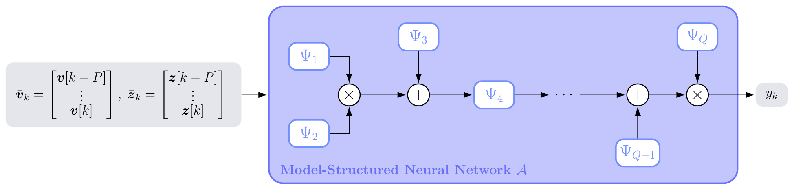
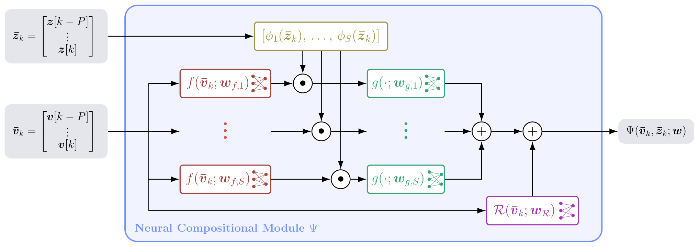

## Abstract

Accurate and interpretable models of physical-system dynamics are fundamental to simulation, prediction, and control. First-principles models provide physical consistency and interpretability but often rely on simplifying assumptions, whereas purely data-driven neural networks offer greater expressive power at the expense of data efficiency. This paper introduces Model-Structured Neural Networks (MSNNs), a methodology for learning physical-system dynamics by embedding physics priors directly into neural architectures. Rather than enforcing physics through loss-function constraints, MSNNs encode prior knowledge through Neural Compositional Modules (NCMs), modular building blocks representing physically meaningful dynamic effects. We formalize a compositional framework in which NCMs are combined through algebraic operations and equipped with physics-encoded input-output transformations, operating-regime-dependent activations, residual components, and temporal memory, enabling the representation of complex dynamics while preserving interpretability and modularity. A further contribution is nnodely, a new open-source library providing an end-to-end workflow for MSNN definition, training, validation, inference, and export. The methodology is evaluated on four simulated and real-world engineering case studies involving single and double inverted pendula, friction learning for a Unitree Z1 manipulator, and lateral vehicle dynamics learned from public Ferrari 250 LM telemetry. Across these applications, MSNNs preserve physically interpretable structure while achieving competitive or superior predictive accuracy relative to black-box neural networks and purely model-based approaches. Experiments with progressively reduced training sets and recurrent rollouts further demonstrate improved data efficiency and robust long-horizon prediction. The software, data-generation scripts, and case-study implementations are openly available in the [nnodely](https://github.com/tonegas/nnodely) and [nnodely-applications](https://github.com/tonegas/nnodely-applications) repositories.

## Model-structured neural networks as compositions of modules {toc-text="Compositional MSNN"}

This paper formalizes **Model-Structured Neural Networks (MSNNs)** as a general, physics-encoded methodology for dynamics learning. Instead of adding physical constraints to the loss function, an MSNN encodes prior knowledge directly in its architecture: the network is built by composing **Neural Compositional Modules (NCMs)** \(\Psi_1, \dots, \Psi_Q\), each one representing a physically meaningful dynamic effect (e.g., a force contribution, a friction term, or a regime-dependent behavior). The modules are combined through algebraic operations that mirror the structure of the underlying physical model, so that the resulting network remains modular and interpretable.

The same construction principle is applied to four case studies of increasing complexity — a single and a double inverted pendulum on a cart, friction learning for a Unitree Z1 manipulator, and lateral vehicle dynamics identified from public Ferrari 250 LM telemetry — showing competitive or superior accuracy with respect to black-box neural networks and purely model-based approaches, together with better data efficiency and robust long-horizon rollouts.

### MSNN architecture (Figure 1)

**Figure 1** shows the general MSNN architecture \(\mathcal{A}\), obtained by composing the NCMs \(\Psi_1, \dots, \Psi_Q\). At each time step \(k\), the network receives the predictive inputs \(\bar{\boldsymbol{v}}_k\), built from the physical variables \(\boldsymbol{v}[k]\) over a memory window of length \(P\), and the scheduling variables \(\bar{\boldsymbol{z}}_k\). Depending on the available measurements and on the intended model structure, \(\bar{\boldsymbol{v}}_k\) may contain the current value and past histories of controls and states, so the same formulation covers Markovian and non-Markovian state-space models, partially observed and delayed systems, and finite-memory input-output models. Each NCM learns a specific aspect of the system dynamics, such as a physical force or a frequency-dependent dynamic effect, and is specialized according to the available prior knowledge, the modeling assumptions, and the desired level of interpretability. The NCMs are then combined through sums, products, and cascaded compositions — mirroring the structure of the physical model — to produce the scalar output \(y_k\).

::: {.paper-network-figures}
{fig-alt="MSNN architecture: inputs v_k and z_k feed a network of Neural Compositional Modules Psi_1 to Psi_Q combined through sums, products and cascades to produce y_k" width=95%}
:::

### Neural Compositional Module (Figure 2)

**Figure 2** shows the internal structure of an NCM \(\Psi\). The module receives the finite temporal input \(\bar{\boldsymbol{v}}_k\), built from the model variables over a memory window of length \(P\), and the scheduling variable \(\bar{\boldsymbol{z}}_k\), which selects the operating regime. The scheduling variable is mapped into the activation functions \(\phi_s(\bar{\boldsymbol{z}}_k)\), \(s = 1, \dots, S\), one for each local model. In each branch, a learnable nonlinear input function \(f(\bar{\boldsymbol{v}}_k; \boldsymbol{w}_{f,s})\) generates local features, which are weighted by the corresponding activation and then processed by an output temporal operator \(g(\cdot; \boldsymbol{w}_{g,s})\), for instance a finite-memory (FIR) operator. The functions \(f\) and \(g\) share the same structure across branches, while their parameters are regime-dependent. The branch outputs are summed and optionally complemented by a black-box residual network \(\mathcal{R}(\bar{\boldsymbol{v}}_k; \boldsymbol{w}_{\mathcal{R}})\), which accounts for unmodeled effects or approximation errors.

::: {.paper-network-figures}
{fig-alt="Neural Compositional Module: scheduling activations, regime-dependent input functions f, temporal operators g, and residual network R summed into the module output" width=95%}
:::

The whole workflow — MSNN definition, training, validation, inference, and export — is implemented in the open-source **nnodely** framework introduced in this paper.
