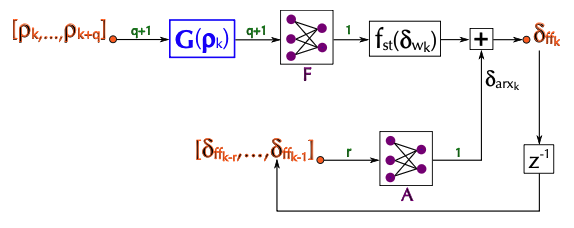

## Abstract

This paper presents a framework to plan and execute autonomous parking maneuvers in complex parking scenarios. We formulate a minimum-time optimal control problem for trajectory planning, using an indirect optimal control approach. A novel smooth penalty function is devised for collision avoidance with optimal control, and an effective technique is adopted to compute an initial solution guess. The trajectory planning tasks are solved with low computational times, and a dense mesh is used to discretize the domain of the optimal control problems, resulting in accurate collision-free solutions. The planned parking maneuvers are tracked with an original pseudo-neural feedforward-feedback steering controller, which outperforms other techniques from the literature, and a feedback longitudinal controller, to drive a realistic 14-degree-of-freedom vehicle simulator. We validate the planning and tracking algorithms in challenging narrow parking scenarios, including reverse, parallel and angle parking, and unstructured environments. The framework robustness is assessed by changing the vehicle mass, the road adherence conditions, and by introducing measurement noise with realistic sensor models. A video of the trajectory planning and tracking results is available as supplementary material.

## Pseudo-neural steering controller {toc-text="pNN"}

The parking maneuvers are planned by solving minimum-time optimal control problems, and then tracked with a feedforward-feedback steering controller. The feedforward part, called **pNN** (pseudo-neural network), has a **physics-driven structure**: instead of a generic black-box network, its layers mirror the low-speed steering dynamics of the vehicle. As a result it needs few learnable parameters and little training data, yet it models the nonlinear relation between the planned trajectory curvature $\rho$ and the steering wheel angle accurately.

pNN is a discrete-time dynamical system (sampling time $T_{s,NN} = 0.05$ s). At each step $k$ it receives a window of present and future optimal curvatures $\boldsymbol{\rho}_k = [\rho_k, \dots, \rho_{k+q}]$ from the planner, together with its own past outputs, and computes the feedforward steering angle $\delta_{ff_k}$. A feedback controller then corrects the residual tracking errors.

### Structure of the pseudo-neural network (Figure 7)

**Figure 7** shows the internal structure of pNN, $\delta_{ff_k} = f_{st}\big(G(\boldsymbol{\rho}_k)\,F^T\big) + [\delta_{ff_{k-r}}, \dots, \delta_{ff_{k-1}}]\,A^T$:

1. **Functional layer $G(\boldsymbol{\rho}_k)$.** Applies the static map $g(\rho)$ to each curvature in the window, giving $q+1$ steady-state predictions of the front-wheel steering angle $\delta_w$. The map comes from the vehicle *curvature diagram*, $\tan(\delta_w) - \rho L = h_1\rho + h_2\rho^3 + h_3\rho^5$, where $L$ is the wheelbase and the coefficients $h_i$ are learned.
2. **Fully-connected layer $F$.** Linearly combines the $q+1$ steady-state predictions. This models part of the transient response and the delays between the steering input and the resulting curvature, giving a first estimate of $\delta_{w_k}$.
3. **Functional layer $f_{st}(\cdot)$.** An identified static steering map (a lookup table) that converts the front-wheel angle $\delta_{w_k}$ into the steering wheel angle.
4. **Fully-connected layer $A$ with unit delay $z^{-1}$.** An auto-regressive term, $\delta_{arx_k}$, that linearly combines the last $r = 15$ outputs of pNN to further refine the steering dynamics.

Since each block has a clear physical meaning (steady-state curvature–steering relation, transient dynamics, steering map, auto-regressive memory), the controller is explainable. In tests it outperforms other tracking techniques from the literature, and it stays robust when the vehicle mass, the road adherence and the sensor noise change.

::: {.paper-network-figures}
{fig-alt="Structure of the pseudo-neural steering controller pNN: future curvature window through functional layer G and fully-connected layer F, steering map f_st, plus auto-regressive layer A on past steering angles with unit delay" width=95%}
:::

The pNN controller is an example of the **model-structured neural network (MSNN)** approach: physical knowledge sets the network topology, and only a few interpretable parameters are learned. Such architectures can be implemented with the **nnodely** framework developed in the Neu4mes project.
