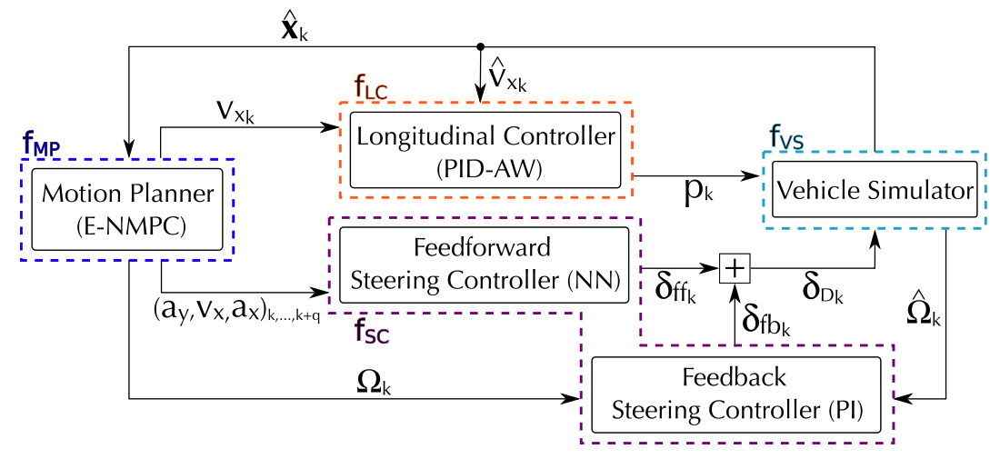
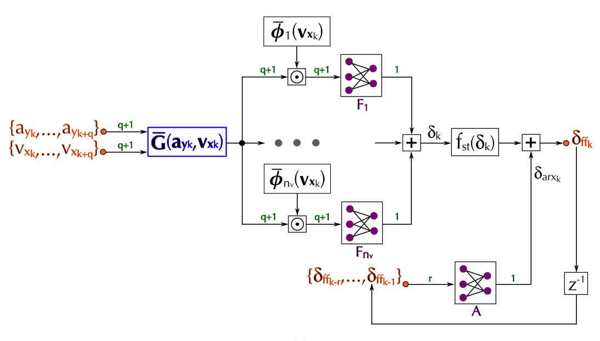
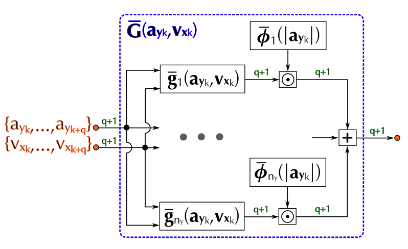
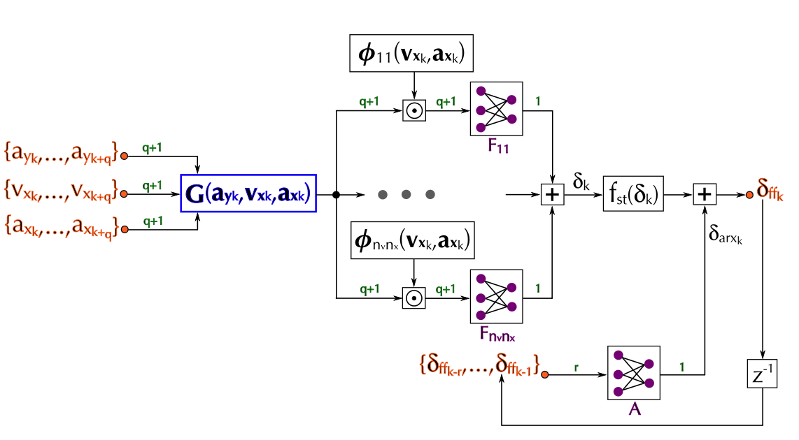
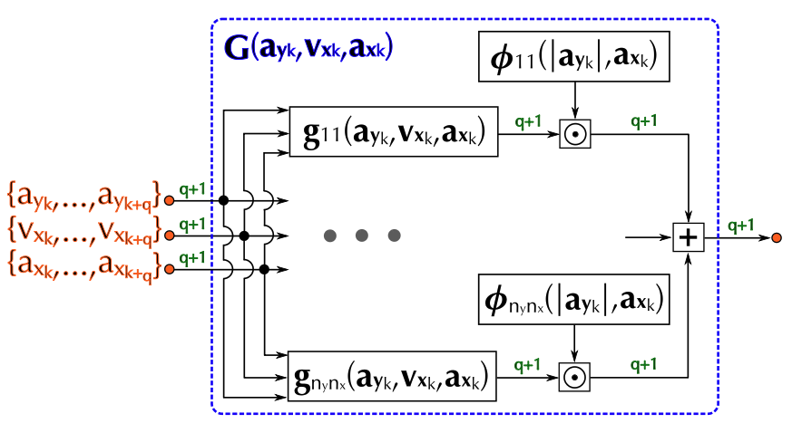

## Abstract

This paper presents a hierarchical framework with novel analytical and neural physics-driven models, to enable the online planning and tracking of minimum-time maneuvers, for a vehicle with partially-unknown parameters. We introduce a lateral speed prediction model for high-level motion planning with economic nonlinear model predictive control (E-NMPC). A low-level steering controller is developed with a novel feedforward-feedback physics-driven artificial neural network (NN). A longitudinal dynamic model is identified to tune a low-level speed-tracking controller. The high- and low-level control models are identified with an automatic three-step scheme, combining open-loop and closed-loop maneuvers to model the maximum acceleration G-G-v performance constraint for E-NMPC, and to capture the effect of the longitudinal acceleration on the lateral dynamics. The proposed framework is used in a simulation environment, for the online closed-loop control of a highly detailed sedan vehicle simulator, whose parameters are partially-unknown. Two different circuits are adopted to validate the approach, and a robustness analysis is performed by varying the vehicle mass and the load distribution. A minimum-time optimal control problem is solved offline and used for a comparison with the closed-loop results. A video demonstrating both the automatic three-step identification scheme and the motion planning and control results is available at the following link: https://www.youtube.com/watch?v=xQ_T96IjGP8.

## Video {#video}



## Physics-driven neural steering controller {toc-text="Physics-driven NN"}

The paper drives a detailed vehicle simulator whose parameters are mostly unknown, aiming for minimum-time laps. Instead of identifying every tire, suspension and powertrain parameter, or training a deep black-box network, the authors identify compact **physics-driven models**, partly analytical and partly neural. Their structure follows vehicle dynamics laws, which makes them interpretable, lets them generalize, and keeps them light enough for online use.

The core neural component is the feedforward steering controller **NNc**. It inverts the lateral dynamics: given the present and future accelerations and speeds planned by the E-NMPC, it computes the steering wheel angle. It comes in two incremental variants. **NNcbase** learns the pure lateral dynamics, and **NNcext** adds the coupling with the longitudinal acceleration $a_x$. Both are built from local models of the vehicle *handling diagram*, combined through piecewise-linear activation functions, so the network output stays physically meaningful even outside the training data.

### Hierarchical motion planning and control framework (Figure 3)

**Figure 3** shows the overall architecture. Every 80 ms the high-level **E-NMPC motion planner** $f_{MP}$ solves a receding-horizon minimum-time problem. Its model includes a lateral speed prediction and the learned G-G-v acceleration constraints. The planned speed $v_x$ goes to the longitudinal controller $f_{LC}$ (PID with anti-windup), which commands the pedal $p$. The planned sequences $(a_y, v_x, a_x)_{k,\dots,k+q}$ feed the **feedforward neural steering controller** (NN). Its output $\delta_{ff_k}$ is added to the correction $\delta_{fb_k}$ of a PI feedback controller on the yaw rate $\Omega$ to give the steering command $\delta_{D_k}$ applied to the vehicle simulator $f_{VS}$.

::: {.paper-network-figures}
{fig-alt="Hierarchical framework: E-NMPC motion planner sending speed to a PID longitudinal controller and future accelerations and speeds to a feedforward neural steering controller, combined with a PI feedback steering controller driving the vehicle simulator" width=95%}
:::

### Neural controller for the pure lateral dynamics (Figure 8a)

**Figure 8(a)** shows **NNcbase**: $\delta_{ff_k} = f_{st}\big(\sum_{j=1}^{n_v} (\bar{G}(\mathbf{a}_{y_k}, \mathbf{v}_{x_k}) \odot \bar{\phi}_j(\mathbf{v}_{x_k}))\,F_j^T\big) + [\delta_{ff_{k-r}}, \dots, \delta_{ff_{k-1}}]\,A^T$.

The threading layer $\bar{G}$ maps the $q+1$ present and future predictions of $a_y$ and $v_x$ to quasi-steady-state steering angles. Its output is routed to $n_v = 4$ single-neuron fully-connected layers $F_j$, each activated by $\bar{\phi}_j(v_x)$ in its own speed range, which model the transient dynamics. The sum of these layers gives the front-wheel angle $\delta_k$. The identified static steering map $f_{st}$ converts it to the steering wheel angle, and the auto-regressive layer $A$ (with the unit delay $z^{-1}$) adds the contribution $\delta_{arx_k}$ of the past outputs.

::: {.paper-network-figures}
{fig-alt="NNcbase: threading layer G-bar on future lateral accelerations and speeds, speed-activated fully connected layers F_1..F_nv, steering map f_st and auto-regressive layer A with unit delay" width=95%}
:::

### Threading layer of the handling diagram (Figure 8c)

**Figure 8(c)** expands $\bar{G}(\mathbf{a}_{y_k}, \mathbf{v}_{x_k})$. It approximates the handling diagram $\delta - \rho L = K_{us}(a_y, v_x)$, with curvature $\rho = a_y / v_x^2$ and wheelbase $L$, using $n_y = 6$ local linearizations $\bar{g}_i(a_y, v_x) = \frac{a_y}{v_x^2}L + k_{1i}\,\mathrm{sign}(a_y) + k_{2i}\,(a_y - a_{y0i}\,\mathrm{sign}(a_y))$. Each linearization is centered at $|a_y| = a_{y0i}$ and weighted by an activation function $\bar{\phi}_i(|a_y|)$. These functions are piecewise linear and form a partition of unity. Only the coefficients $k_{1i}$, $k_{2i}$ are learned, and the weighted sum covers the whole nonlinear under/oversteering characteristic of the vehicle.

::: {.paper-network-figures}
{fig-alt="Expanded threading layer G-bar: local handling-diagram models g-bar_i weighted by lateral-acceleration activation functions and summed" width=80%}
:::

### Extended controller with longitudinal–lateral coupling (Figure 8b)

**Figure 8(b)** shows **NNcext**. It adds the future longitudinal accelerations $\mathbf{a}_{x_k}$ as an input, so the controller captures how braking and traction change the steering response. The structure matches NNcbase, but the transient layers become $n_v \cdot n_x$ layers $F_{jl}$, activated by $\phi_{jl}(v_x, a_x) = \bar{\phi}_j(v_x)\,\bar{\phi}_l(a_x)$ over a grid of speed and longitudinal-acceleration ranges ($n_x = 4$). The two networks are trained one after the other: NNcbase first, then NNcext.

::: {.paper-network-figures}
{fig-alt="NNcext: threading layer G on future lateral accelerations, speeds and longitudinal accelerations, fully connected layers F_11..F_nvnx activated by speed and longitudinal acceleration, steering map and auto-regressive layer" width=95%}
:::

### Threading layer with combined dynamics (Figure 8d)

**Figure 8(d)** expands $G(\mathbf{a}_{y_k}, \mathbf{v}_{x_k}, \mathbf{a}_{x_k})$. It combines $n_y \cdot n_x$ local models $g_{il}$, each activated near $\{|a_y|, a_x\} = \{a_{y0i}, a_{x0l}\}$ by $\phi_{il} = \bar{\phi}_i(|a_y|)\,\bar{\phi}_l(a_x)$. The local models come from linearizing a nonlinear double-track vehicle model around quasi-steady-state conditions. The lateral parameters $k_{y1i},\dots,k_{y6i}$ are kept separate from the longitudinal ones $k_{x1l},\dots,k_{x5l}$, which reduces the learnable parameters of $G$ from $11\,n_y n_x$ to $6 n_y + 5 n_x$ with little loss in accuracy.

::: {.paper-network-figures}
{fig-alt="Expanded threading layer G: local models g_il of the coupled longitudinal-lateral dynamics weighted by activation functions of lateral and longitudinal acceleration and summed" width=80%}
:::

The physics-driven structure supports incremental learning: if no data are available in the nonlinear handling regions, the network still learns the linear steering behavior, and it does not produce unrealistic outputs in conditions it was not trained on. This design is a clear example of the **model-structured neural network (MSNN)** approach, and such architectures can be implemented with the **nnodely** framework developed in the Neu4mes project.
