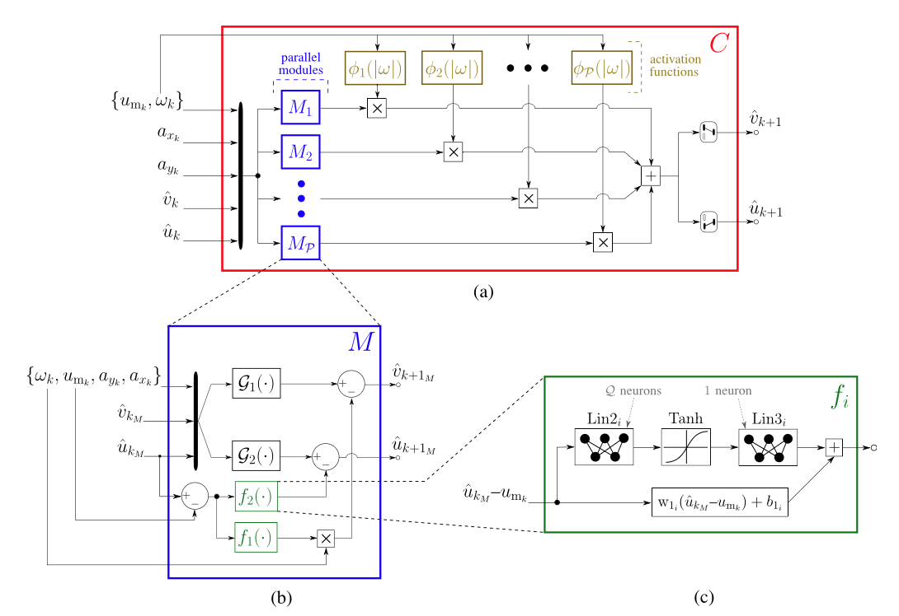

## Abstract

This paper presents kinematics-structured neural networks (KS-NN) for the lateral speed estimation of vehicles. The internal structure of the networks is designed to incorporate the kinematic principles, enhancing the physical explainability and generalization capacity. Both the internal structure and training method are devised for better generalization performance. Various linear and nonlinear variants of our estimator are assessed for accuracy and robustness. The approach is validated using an openly accessible dataset with two race cars. The performance of the novel networks is evaluated against Luenberger, neural network, factor graph and Kalman filter estimators from the literature. In comparison with a Luenberger kinematic observer, our networks improve noise rejection, and overcome the well-known observability problem for low yaw rates. Compared to existing neural network estimators, our networks exhibit better generalization capacity, are more sample-efficient, require fewer learnable parameters, and their structure is physically explainable.

## Kinematics-structured neural network for lateral velocity estimation {toc-text="KS-NN"}

The paper addresses the estimation of the vehicle lateral velocity $v$ from standard on-board measurements: yaw rate $\omega$, measured forward speed $u_m$, and accelerations $a_x$, $a_y$. Pure kinematic observers do not depend on vehicle-specific parameters, but are sensitive to noise and become unobservable when $\omega \to 0$ (e.g., on straights); black-box neural estimators, on the other hand, are not explainable and generalize poorly. The proposed **kinematics-structured neural network (KS-NN)** hard-wires the kinematic equations into the network topology, so that the learned model is a generalized Luenberger-like observer.

KS-NN works as a memoryless recurrent network (FIR system): at each step $k$ a window of $N=30$ past measurements (1.5 s at $\tau = 0.05$ s) is used to unroll the recurrence that estimates $\{\hat{v}_{k+1}, \hat{u}_{k+1}\}$ from a standard initial state. With only a few dozen learnable parameters, the resulting model can be read as a linear parameter-varying (LPV) system, and it outperforms GRU/LSTM, Luenberger, factor-graph and Kalman-filter benchmarks in generalization across two race cars (Ferrari and Corvette).

### Internal architecture of the recurrent block (Figure 2)

**Figure 2** shows the structure of the recurrent block $C$ that is unrolled over the measurement window.

- **(a) Combination of parallel modules.** $C$ is a bank of $P$ Luenberger-like local modules $M_1, \dots, M_P$ combined via *channel coding*. Each module output is weighted by an activation function $\phi_p(|\omega|)$, piecewise linear in $|\omega|$, with local support and forming a partition of unity ($\sum_p \phi_p(|\omega|) = 1$). Each module thus specializes in a specific range of yaw rates, and the overall estimate is the interpolation $[\hat{v}_{k+1}, \hat{u}_{k+1}]^T = \sum_{p} \phi_p(|\omega_k|)\,[\hat{v}_{k+1}^{M_p}, \hat{u}_{k+1}^{M_p}]^T$.
- **(b) Neural module $M$.** Each module is a generalized explicit-Euler discretization of the kinematic observer: $\hat{v}_{k+1} = \gamma_1 \hat{v}_k + \beta_1 \tau (a_{y_k} - u_{m_k}\omega_k) - \omega_k f_1(\hat{u}_k - u_{m_k})$ and $\hat{u}_{k+1} = \gamma_2 \hat{u}_k + \beta_2 \tau (a_{x_k} + \hat{v}_k \omega_k) - f_2(\hat{u}_k - u_{m_k})$. The blocks $\mathcal{G}_1(\cdot)$, $\mathcal{G}_2(\cdot)$ implement the kinematic prediction, while the learnable gains $\gamma_i$, $\beta_i$ improve noise rejection and overcome the unobservability at low yaw rates.
- **(c) Feedback sub-networks $f_i$.** The drift indicator $\hat{u}_k - u_{m_k}$ is fed back through a two-branch shallow network: a linear branch $w_{1_i}(\hat{u}_k - u_{m_k}) + b_{1_i}$ and a nonlinear branch with $Q$ Tanh neurons followed by one linear neuron. Each module has at most $6Q + 8$ parameters, so the whole KS-NN has at most $(6Q+8)P$.

Because every parameter has a physical role (kinematic integration, drift feedback, yaw-rate scheduling), the network is interpretable and sample-efficient, and its best variant ("nonlinear, no bias") shows the highest robustness when trained on one car and tested on the other.

::: {.paper-network-figures}
{fig-alt="KS-NN architecture: (a) recurrent block C as combination of P parallel modules M weighted by yaw-rate activation functions; (b) internal structure of module M with kinematic blocks G1, G2 and feedback functions f1, f2; (c) structure of the feedback sub-network f_i with linear and Tanh branches" width=95%}
:::

This kinematics-structured design is a direct example of the **model-structured neural network (MSNN)** approach, and this kind of architecture can be implemented with the **nnodely** framework developed in the Neu4mes project.
